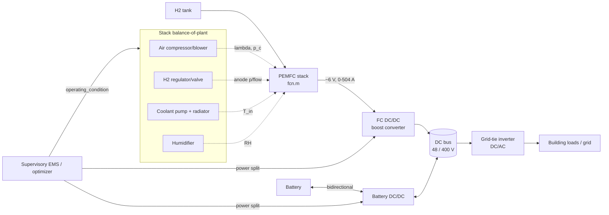

# PEMFC Stack — Control Architecture Sketch

Control-model plan for the `PEMFC Stack` block (`fcn.m`). Target application, system
layout, control hierarchy, and the dynamics to add so the block is a controllable plant
rather than a static map.

---

## 1. Application framing

**Recommended: grid-tied FC + battery hybrid for peak shaving / prime / CHP (continuous).**

- The stack is ~3 kW gross / ~2.6 kW net at BoL (10 cells x 280 cm2, ~504 A, ~6 V at full load).
  That is residential / light-commercial scale; for a commercial building, treat one stack as a
  **module** and replicate N of them.
- The project's value is the **degradation model (0-2300 h) + operating-point optimizer**. Those
  only pay off in a **continuously running** duty, where efficiency and aging accumulate. Pure
  residential backup runs a few hours a year and barely exercises the aging model — keep it only
  as a secondary mode.
- The FC is **not** the energy store: storage = **H2 tank** (energy) + **battery** (fast buffer).

---

## 2. System architecture



---

## 3. Control hierarchy

Three layers, fast to slow at the bottom.

### L3 — Supervisory / energy management (slow, seconds to hours)
- **Decides:** FC vs battery vs grid power split; FC power (current) command; optimal BoP
  setpoints `[p_c, lambda_c, T_in, RH_c]` **as a function of age** (the optimizer / MPC output).
- **Uses:** the degradation model in `fcn.m` + load forecast + state of charge + stack age.
- **Outputs:** `I_fc_cmd` (or `j_cmd`) to L1, `operating_condition` setpoints to L2.

### L2 — Stack balance-of-plant (medium, 0.1-10 s)
Each actuator tracks an L3 setpoint with a local loop:

| Loop | Actuator | Controls | Note |
|---|---|---|---|
| Air | compressor / blower | cathode stoichiometry `lambda_c`, pressure `p_c` | **feedforward from current** |
| Fuel | H2 regulator / valve | anode pressure, flow | pressure tracking |
| Thermal | coolant pump + radiator/bypass | `T_in` / cell temperature | slow, large lag |
| Humidity | humidifier | cathode `RH` | couples with thermal |

### L1 — Power electronics (fast, ms)
- **FC DC/DC converter** — current loop that pulls `I_fc_cmd` from the stack (the load-following actuator).
- **Battery bidirectional DC/DC** — regulates **DC-bus voltage**; absorbs/supplies the transient delta the FC can't follow.
- **Grid-tie inverter** — DC bus to AC; real/reactive power to building or grid.

---

## 4. Load-regulation signal path

```
load demand -> EMS -> FC power command -> I_fc_cmd -> FC DC/DC current loop -> stack current j
                                   |-> battery covers (demand - FC) during the ramp
     current command -> air feedforward -> compressor -> lambda_c  (lead the current!)
```

- A fuel cell is **current-controlled**: commanding `j` via the DC/DC converter sets power.
  There is no throttle.
- **Oxygen-starvation protection is the core loop:** air flow must *lead* a current step, so
  `lambda_c` is driven by a **feedforward from `I_fc_cmd`** plus a fast compressor loop; the
  battery covers the power gap while air catches up.

---

## 5. Plant dynamics to add (the block is currently algebraic)

`fcn.m` is a static map. For a control study, wrap it with first-order lags so transients exist:

- **Air / cathode O2:** first-order lag on effective `lambda_c` behind the compressor command,
  tau ~ 0.5-2 s (typical; tune). This is what makes starvation possible.
- **Thermal:** first-order (or 2-state) lag from `T_in` command to cell temperature, tau ~ tens
  of seconds to minutes. Replaces the algebraic `avg_cell_temperature`.
- **Anode pressure / humidity:** first-order lags, tau ~ 1-5 s.
- **Electrical:** optional double-layer capacitance (fast, ms) if you want the voltage transient;
  usually negligible vs the air loop.
- **Battery + DC bus:** SoC integrator, bus-voltage state, averaged DC/DC models.

(Time constants above are typical placeholders — tune to the hardware; they are not from this dataset.)

---

## 6. Key control challenges to capture

1. **O2 starvation** on load steps -> air feedforward + battery buffer.
2. **Slow FC ramp + thermal lag** -> battery handles the moving delta, FC handles the average.
3. **Degradation-aware scheduling** -> supervisor re-tunes setpoints and power split as the stack
   ages, using the model in the block (the project's contribution).

---

## 7. Suggested Simulink subsystem breakdown

- `PEMFC Stack` (have it) — add the L2 actuator lags around `fcn.m`.
- `Power Electronics` — FC DC/DC current loop, battery bidirectional DC/DC, inverter, DC bus.
- `Battery + Tank` — SoC and H2 inventory integrators.
- `Supervisory EMS` — power split + age-scheduled setpoints (static lookup first; MPC later).
- `Load / Grid` — demand profile (and peak-shaving target) driving the whole thing.
